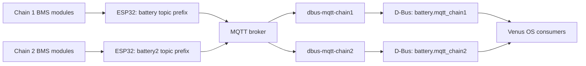

# MQTT battery architecture

ESP32 firmware reads JBD battery modules and publishes their measurements to
MQTT. Each configured `dbus-mqtt-battery` process validates and aggregates one
chain, then publishes a Victron battery service on D-Bus. Venus OS consumers
read those services; the bridge does not discover or aggregate other D-Bus
battery services.



## Chain configuration and freshness

SetupHelper creates the number of processes declared by `chains`, with
`batteries` modules and `cellsPerBms` cells per module. Defaults are two chains,
four modules per chain and four cells per module. Chain 1 uses topic prefix
`battery`; later chains use `battery2`, `battery3`, and so on. Each publisher
normally numbers its BMS modules from 1. `bmsFirstN` can select a different first
module for chain N; the publisher's topic prefix and module IDs must match the
configured process.

New installations use atomic telemetry. Every configured BMS must provide the
required complete, fresh physical measurements and permissions before the
chain becomes available. A missing module cannot disappear from aggregation;
stale or incomplete input disconnects the chain and withholds charging evidence.
See the [readiness contract](../../README.md#aggregate-telemetry-freshness) and
[producer protocol](../../README.md#black-start-and-telemetry-readiness)
before changing a deployed firmware/driver pair.

## Troubleshooting

Check the configured chain's supervisor, log and D-Bus connection status. These
commands inspect chain 1; substitute the corresponding number for another chain:

```sh
svstat /service/dbus-mqtt-chain1
tail -n 50 /var/log/dbus-mqtt-chain1/current
dbus -y com.victronenergy.battery.mqtt_chain1 /Connected GetValue
```

A running process alone does not establish fresh battery readings. Check the
producer's MQTT connection, topic prefix, module IDs and complete telemetry
when the D-Bus service remains disconnected.

- [Installation and configuration](../../README.md#configuration-options)
- [Protected local broker profile](../../docs/secure-local-broker.md)
- [Implementation and assurance](../../docs/project-assurance.md)
